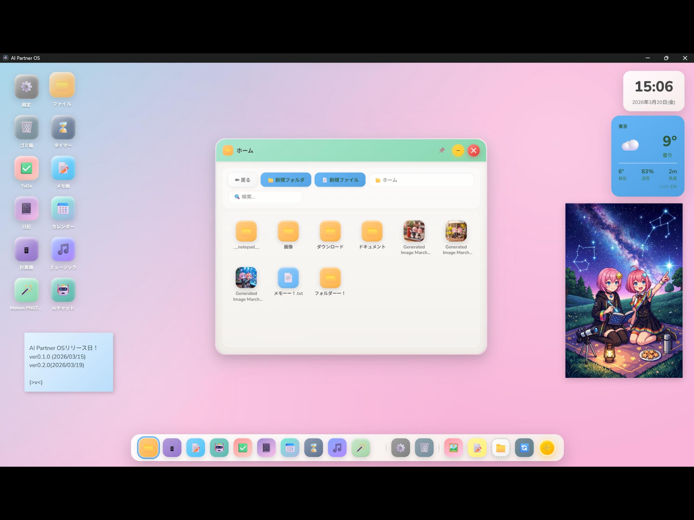

# 虚拟电脑（噜噜电脑）

需求见 AI_Corp #45《虚拟电脑 PRD 1.0》。这个文件夹存放项目资料，代码以后放独立仓库。

## 视觉参考图

`reference/ui-reference-01.png`：噜噜小兵 2026-10-30 提供，对应 PRD 2.1「视觉示意图」。图里是别人的产品（AI Partner OS），只参考风格，不照搬界面、图标和图片。

从图里借鉴的：

- 底色：浅蓝到浅粉的柔和渐变壁纸。
- 图标：圆角方块、低饱和糖果色、带一点光泽和柔和阴影，图标下面写名字。
- 窗口：大圆角、白色半透明主体、彩色标题栏（每个应用可以不同颜色），右上角是圆形的最小化 / 关闭按钮。
- 底部是居中的圆角 Dock（固定应用 + 已打开的应用），代替传统的贴底任务栏。
- 桌面小组件：时钟日期、天气、便签、相框（噜噜之家已有天气、日历、相框的数据和组件，可以直接复用）。
- 按钮：圆角胶囊形，浅蓝底白字。

界面文字用中文。
